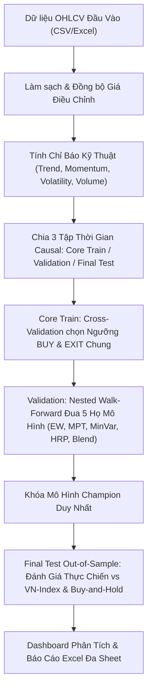

# 📈 HOSE V4 Quantitative Portfolio Backtester — Streamlit Web App

Ứng dụng web định lượng tài chính chuyên nghiệp xây dựng trên nền tảng **Streamlit**, dùng để kiểm định (backtest) và tối ưu hóa danh mục đầu tư theo phương pháp **Nested Walk-Forward** không rò rỉ dữ liệu tương lai (**No Future Leakage**) kết hợp **Market Regime** và **Chính sách Tiền mặt tối đa 40%** trên thị trường chứng khoán Việt Nam (HOSE).

---

## 🌟 Tính Năng Nổi Bật

1. **Chuẩn Hóa Dữ Liệu Tự Động (Smart Data Ingestion)**:
   - Tự động nhận diện cấu trúc file CSV / Excel từ các nguồn phổ biến tại Việt Nam (CafeF, Vietstock, FireAnt, SSI, VNDIRECT...) và quốc tế.
   - Hỗ trợ giá điều chỉnh (`adj_close`), tự động scale toàn bộ giá Open, High, Low theo tỷ lệ điều chỉnh để loại bỏ các khoảng nhảy giá do cổ tức/chia tách cổ phiếu.
   - Tự động xử lý lỗi font, ký tự phân cách phần nghìn `,` trong khối lượng khớp lệnh.
   - Nếu không có mã VN-Index, hệ thống tự động tạo **Synthetic Market Proxy** (Equal-Weight) làm benchmark chuẩn đối chứng.

2. **Chỉ Báo Kỹ Thuật & TA Score (0–10)**:
   - Tích hợp 4 nhóm chỉ báo:
     - **Trend (Xu hướng)**: EMA20, EMA50, EMA200, MACD / Signal.
     - **Momentum (Động lượng)**: RSI Wilder (14), ROC (10), Khoảng cách đỉnh 52 tuần.
     - **Volume (Khối lượng)**: Khối lượng giao dịch so với MA20, On-Balance Volume (OBV).
     - **Volatility (Biến động)**: ATR(14) %, ATR Percentile 90 phiên.

3. **Thiết Kế Chống Rò Rỉ Dữ Liệu Tương Lai (No Future Leakage Audit)**:
   - **Core Train**: Tối ưu hóa ngưỡng `BUY/EXIT` chung cho toàn thị trường qua K-Fold Cross-Validation.
   - **Validation**: Đua mô hình phân bổ và chọn mô hình **Champion** duy nhất (khóa cứng).
   - **Final Test (Out-of-Sample)**: Đánh giá độc lập mô hình Champion mà không điều chỉnh lại bất kỳ tham số nào.
   - Tín hiệu giao dịch tại `Close(t-1)` chỉ được khớp lệnh tại `Open(t)`.

4. **Nested Walk-Forward Causal**:
   - Tái chọn danh mục **Top N cổ phiếu theo quý (Q)** dựa trên thông tin quá khứ đến phiên `t-1`.
   - Cập nhật trọng số danh mục **hàng tháng (M)**.
   - Hỗ trợ 5 họ mô hình tối ưu hóa danh mục hiện đại:
     - **EW**: Equal Weight (Tỷ trọng đều).
     - **MPT-LW**: Modern Portfolio Theory với Ledoit-Wolf Covariance Shrinkage & L2 Regularization.
     - **MINVAR-LW**: Tối thiểu hóa phương sai (Minimum Variance).
     - **HRP**: Hierarchical Risk Parity (Phân bổ rủi ro theo cụm phân cấp).
     - **BLEND50**: Trộn 50% MPT-LW và 50% EW để giảm sai số ước lượng.

5. **Risk Overlay & Chính Sách Tiền Mặt Mục Tiêu 40% (cash40)**:
   - **Market Regime**: Nhận diện thị trường Bullish/Bearish qua EMA200 ngày của VN-Index kết hợp độ dốc (EMA slope).
   - **Stock Active Mask**: Bộ lọc trạng thái cổ phiếu dựa trên ngưỡng TA Score.
   - **Chính sách tiền mặt `cash40`**: Can thiệp sau bộ lọc rủi ro, duy trì tỷ trọng cổ phiếu tối thiểu 60% khi giải ngân (tiền mặt không quá 40%), cân bằng giữa phòng thủ và nắm bắt đà tăng trưởng.

6. **Trực Quan Hóa & Xuất Báo Cáo Chuyên Nghiệp**:
   - Biểu đồ Plotly tương tác: Đường cong NAV chuẩn hóa, Biểu đồ sụt giảm tài sản (Underwater Drawdown), Phân bổ tài sản theo thời gian.
   - Bảng đối chiếu chỉ số định lượng: CAGR, Sharpe, Sortino, MaxDD, Calmar, Turnover, Avg Cash...
   - Xuất trọn bộ báo cáo sang file **Excel đa sheet (.xlsx)** và chuỗi dữ liệu NAV hàng ngày sang file **CSV**.

---

## 📁 Cấu Trúc Thư Mục Repository

```text
├── app.py                                        # Mã nguồn chính của ứng dụng Streamlit
├── requirements.txt                              # Danh sách thư viện phụ thuộc
├── README.md                                     # Tài liệu hướng dẫn sử dụng & triển khai
└── HOSE - 01.01.2021 - 31.12.2025 (97 mã).csv    # File dữ liệu mẫu OHLCV 97 mã HOSE (2021–2025)
```

---

## 💻 Hướng Dẫn Cài Đặt & Chạy Tại Máy Cá Nhân (Local)

### 1. Yêu cầu hệ thống
- Đã cài đặt **Python 3.9+** (khuyến nghị Python 3.10 hoặc 3.11).
- Trình quản lý gói `pip` hoặc môi trường ảo `venv` / `conda`.

### 2. Cài đặt các thư viện phụ thuộc
Mở terminal / PowerShell tại thư mục dự án và chạy lệnh:
```bash
pip install -r requirements.txt
```

### 3. Khởi chạy ứng dụng Web
Chạy lệnh sau:
```bash
streamlit run app.py
```
Sau khi chạy, trình duyệt web sẽ tự động mở địa chỉ: `http://localhost:8501`.

---

## 🚀 Hướng Dẫn Tải Lên GitHub & Deploy Lên Streamlit Cloud

### Bước 1: Khởi tạo và Đẩy code lên GitHub
1. Đăng nhập vào [GitHub](https://github.com/) và tạo một repository mới (ví dụ đặt tên là: `hose-v4-quant-portfolio`).
2. Mở terminal tại thư mục chứa 3 file (`app.py`, `requirements.txt`, `README.md` cùng file dữ liệu `.csv`) và chạy các lệnh:
   ```bash
   git init
   git add app.py requirements.txt README.md *.csv
   git commit -m "feat: Initial commit HOSE V4 Quantitative Backtester web app"
   git branch -M main
   git remote add origin https://github.com/<tai-khoan-github-cua-ban>/hose-v4-quant-portfolio.git
   git push -u origin main
   ```

### Bước 2: Deploy miễn phí trên Streamlit Community Cloud
1. Truy cập [share.streamlit.io](https://share.streamlit.io/) và đăng nhập bằng tài khoản GitHub của bạn.
2. Nhấn nút **"Create app"** (hoặc **"New app"**).
3. Điền thông tin cấu hình:
   - **Repository**: Chọn repository bạn vừa đẩy lên (ví dụ: `<tai-khoan-github>/hose-v4-quant-portfolio`).
   - **Branch**: `main`
   - **Main file path**: `app.py`
4. Nhấn **"Deploy!"**.
5. Trong vòng 1–2 phút, Streamlit Cloud sẽ tự động cài đặt thư viện từ `requirements.txt` và khởi chạy web app trực tiếp trên môi trường đám mây với đường link công khai (ví dụ: `https://hose-v4-quant-portfolio.streamlit.app`).

---

## 📊 Định Dạng Dữ Liệu Đầu Vào

Hệ thống hỗ trợ nạp dữ liệu rất linh hoạt. Bạn có thể sử dụng file dữ liệu mẫu có sẵn hoặc tải lên file CSV/Excel mới có các cột sau:

| Tên Cột Chuẩn | Tên Cột Tiếng Việt Thường Gặp | Diễn Giải | Bắt Buộc? |
| :--- | :--- | :--- | :---: |
| **Ticker** | `Mã`, `Mã CK`, `Symbol` | Mã cổ phiếu (ví dụ: AAA, HPG, FPT...) | **Bắt buộc** |
| **Date** | `Ngày`, `Thời gian`, `TradingDate` | Ngày giao dịch (định dạng `YYYY-MM-DD` hoặc `MM/DD/YYYY`) | **Bắt buộc** |
| **Open** | `Giá mở cửa`, `Mở cửa` | Giá mở cửa phiên | **Bắt buộc** |
| **High** | `Giá cao nhất`, `Cao nhất` | Giá cao nhất phiên | **Bắt buộc** |
| **Low** | `Giá thấp nhất`, `Thấp nhất` | Giá thấp nhất phiên | **Bắt buộc** |
| **Close** | `Giá đóng cửa`, `Đóng cửa` | Giá đóng cửa phiên | **Bắt buộc** |
| **Volume** | `Khối lượng khớp lệnh`, `Khối lượng` | Khối lượng cổ phiếu giao dịch | Tùy chọn (Mặc định 0) |
| **adj_close** | `Giá điều chỉnh`, `Adjusted Close` | Giá đóng cửa sau điều chỉnh cổ tức/thưởng | Tùy chọn |

---

## 🧠 Diễn Giải Thuật Toán & Phương Pháp Luận



1. **Khóa tham số trước khi thử nghiệm**: Tuyệt đối không tinh chỉnh tham số dựa trên kết quả Final Test để tránh overfitting (khớp quá mức dữ liệu quá khứ).
2. **Quản trị rủi ro đa tầng**:
   - **Tầng 1 (Market Regime)**: Hạ tỷ trọng tài sản rủi ro khi VN-Index nằm dưới đường trung bình dài hạn EMA200.
   - **Tầng 2 (Stock Active Mask)**: Tạm dừng nắm giữ cổ phiếu cụ thể khi điểm TA Score suy yếu dưới ngưỡng Exit.
   - **Tầng 3 (Cash Policy 40%)**: Đảm bảo dòng vốn luôn sẵn sàng giải ngân với tỷ trọng cổ phiếu tối thiểu 60%, tránh việc cầm tiền mặt 100% trong thời gian quá dài làm lỡ nhịp phục hồi của thị trường.

---

## 📜 Bản Quyền & Giấy Phép
Dự án được phân phối theo giấy phép mã nguồn mở **MIT License**. Mọi đóng góp (Pull Request, Issue) đều được hoan nghênh!
